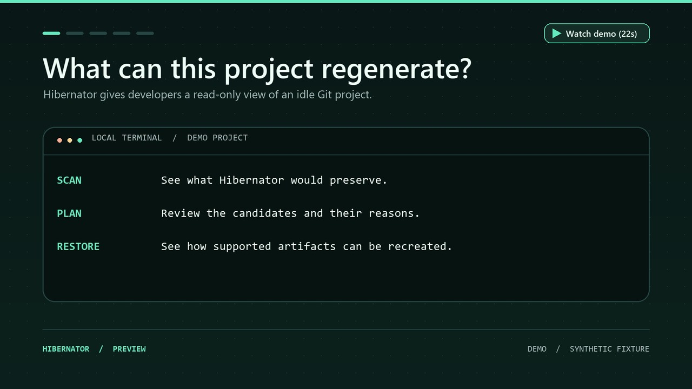

# Hibernator

**See what takes up space in an inactive coding project, then review what could be recreated.**

Hibernator inspects one inactive local Git project and saves a private retirement report. It identifies evidence-backed candidates, estimates logical bytes, and explains what to preserve and how to recover dependencies.

**The owner alone performs manual cleanup in their file manager.** Every Hibernator project operation is read-only.

[](https://github.com/YellankiKaushik/Hibernator-Skill/raw/refs/heads/main/docs/media/hibernator-preview-demo.mp4)

[Watch the earlier 22-second scan, plan and restore preview](https://github.com/YellankiKaushik/Hibernator-Skill/raw/refs/heads/main/docs/media/hibernator-preview-demo.mp4) · [Demo and audio credits](docs/media/README.md)

## Contents

[Install](#installation) · [Quick start](#quick-start) · [Understand the results](#scan-classifications) · [Use an AI agent](#use-hibernator-with-your-ai-coding-agent) · [Safety](#privacy-and-security) · [Get help](#troubleshooting-and-uninstall)

## Why Hibernator?

Old projects accumulate Node dependencies, Python virtual environments, framework caches, bytecode, and build artifacts. Some of these can be recreated from the source and lockfiles. A generated-looking folder can also hold local changes, private data, or files that Git tracks. Folder names and ignore rules alone tell you little about what you can safely recreate.

## How it works

Run `retire` once. A shared inventory measures the working tree, protects tracked and uncertain content, and builds paired Markdown and private JSON reports outside the project. Review the exact paths and the recovery inputs in the Markdown. Any manual cleanup decision belongs to you.

## Scan classifications

| Decision | What it means | Synthetic example |
| --- | --- | --- |
| **KEEP** | Hibernator will preserve this content. | Git-tracked source in `src/` or a secret-like `.env.local` file. |
| **REGENERABLE** | Project evidence supports reviewing the exact artifact for manual cleanup. | `node_modules/` with matching Node project metadata and a lockfile, after content checks. |
| **REVIEW** | The evidence is incomplete or the content needs human judgment. | An unrecognized `local-notes.txt` file. |
| **BLOCKED** | A protection or inspection check excluded the artifact. | A dependency folder containing a secret-like file or a link outside the project. |

**REGENERABLE** marks an advisory candidate. The report can filter eligible candidates by exact path or size.

## What Hibernator supports

- **One working-tree inventory.** Review the largest non-overlapping candidates first. Fast mode uses metadata and bounded recovery evidence. Explicit `--deep` hashes eligible file contents.
- **Private local reports.** Each run saves Markdown, a versioned JSON report, and a completion record. The report distinguishes observed, eligible and offered logical bytes.
- **Recovery guidance.** Review the preserved inputs, suggested working directory, and original toolchain for each candidate.
- **Standalone previews.** `scan`, `plan`, `report` and `restore --dry-run` remain available. The legacy plan still detects content changes using its schema-2 fingerprints.
- **Optional follow-up.** Run `verify` separately to observe listed paths and Git index/HEAD metadata.

See the [CLI reference](docs/CLI.md), [rule explanations](docs/DEPENDENCY_CLASSIFICATION.md) and [usage examples](docs/USAGE_EXAMPLES.md).

## Requirements

- **Python 3.10 or later** and **Git on your PATH**. CI covers Python 3.10–3.14 on Windows, Ubuntu, and macOS.
- Source installation uses `setuptools>=77` as its build backend. The installer may download it if it is unavailable locally. The installed CLI has no third-party runtime dependencies.
- A local terminal with read access to the chosen Git repository and a writable folder outside it for plans and reports.

## Installation

Clone Hibernator into a tools folder, separate from any project you want to inspect. Create an isolated Python environment so the installation stays with this checkout.

### Windows PowerShell

```powershell
git clone https://github.com/YellankiKaushik/Hibernator-Skill.git
Set-Location Hibernator-Skill
py -3 -m venv .venv
.\.venv\Scripts\python.exe -m pip install .
.\.venv\Scripts\hibernator.exe doctor
```

Use `python -m venv .venv` if your Windows installation provides `python` but lacks the `py` launcher. If the Hibernator executable is unavailable, run `.\.venv\Scripts\python.exe -m hibernator doctor`. This also works without enabling PowerShell activation scripts.

### Linux and macOS

```sh
git clone https://github.com/YellankiKaushik/Hibernator-Skill.git
cd Hibernator-Skill
python3 -m venv .venv
.venv/bin/python -m pip install .
.venv/bin/hibernator doctor
```

To upgrade an existing trusted Hibernator checkout, rerun its environment’s `python -m pip install .` command above, then check `hibernator --version`.

Use `.venv/bin/python -m hibernator doctor` if the console command is unavailable. On Linux, install your distribution’s Python venv package if Python reports that it cannot create a virtual environment.

In an activated environment, `hibernator` and `python -m hibernator` run the same CLI. You can also use the full installed command or module path above from the Hibernator checkout.

## Quick start

Choose the exact root of one inactive local Git project. Replace the example path, keeping the quotes.

```text
hibernator retire --project "/work/inactive-demo"
python -m hibernator retire --project "/work/inactive-demo" --format json
```

Use either invocation. To choose a destination, pass `--output` with an existing private directory outside the project and its ancestors. `--show-paths` displays local absolute locations when needed. Read the Markdown, confirm important data and recovery inputs are retained, and stop. Logical bytes estimate file lengths. Hibernator reclaims zero bytes.

The [hands-on guide](docs/USER_TESTING.md) provides a disposable fixture and a separate owner read-only acceptance procedure. The video above shows the earlier preview workflow.

## Use Hibernator with Your AI Coding Agent

Open an agent with local terminal access and grant it permission to inspect only the folder you choose. The README and Agent Skill provide instructions. Filesystem and command access depend on the agent host and its permissions.

- **Codex:** The checkout carries a discoverable project skill. A Codex session has run a synthetic scan with the Hibernator workflow.
- **Claude Code, Gemini CLI, Google Antigravity, and Cursor:** Their documented skill discovery or manual setup is covered in the [Agent Skill guide](docs/AGENTS.md). Hibernator invocation in these hosts has not been verified.
- **Other terminal-capable agents:** Install the CLI where the agent's terminal runs, then paste the prompt below. The prompt works without native skill discovery if the agent can run the CLI.

### Copy-paste prompt

```text
Use Hibernator to prepare a read-only retirement report for this inactive local
Git project. Confirm the exact project root, invoke retire once, summarize the
largest advisory candidates, protected items, limitations and local report
locations, then stop. I alone decide and perform any manual cleanup.
```

See [Agent Skill installation, discovery, and troubleshooting](docs/AGENTS.md). The CLI and skill are installed separately.

## Restoration guidance

`restore --dry-run` reads supported manifests and lockfiles. For example, an npm lockfile can produce a suggested `npm ci` step. Nested projects can receive their own working-directory hints. Review the suggestion and any warnings before running a package manager yourself.

The preview leaves installers unexecuted. Reinstalling dependencies cannot recover local-only files, secrets, databases, custom edits inside generated directories, or data that exists nowhere else. See the [restoration guide](docs/RESTORE_GUIDANCE.md).

## Privacy and security

- Retire, verify, scan, plan, and restore preview work offline and leave the target repository untouched. Plans and saved reports are written outside it.
- Git-tracked content and local changes are protected by conservative rules. Unknown content is preserved or flagged for review. Secret-like names are protected without reading their values for classification.
- Traversal rejects or skips filesystem boundaries such as symlinks, reparse points, nested Git repositories, and different-device entries where applicable. Actual filesystem behavior varies by platform.
- Report and plan digests detect inconsistent or altered data. Private JSON includes a bound local root. Keep both reports, plans, and filenames private.

Production apply is a prompt-free refusal. See the [safety model](docs/SAFETY.md) and [security policy](SECURITY.md).

## Testing and validation

The [verified baseline CI run](https://github.com/YellankiKaushik/Hibernator-Skill/actions/runs/45579668204) passed 18 of 18 jobs for commit `76fda646ec9b9d42f2fc2b87ad84d1502a413fd2`. It covers Python 3.10–3.14 on Windows, Ubuntu, and macOS, including synthetic fixtures, wheel build and installation, installed console startup, and Agent Skill packaging. Windows junction fixture checks and other platform-specific cases can skip. Those cases remain unverified. That run predates retirement. See the [retirement verification record](docs/RETIREMENT_VALIDATION.md) for measurements of this revision.

See [testing instructions](docs/TESTING.md) and the [release gate matrix](docs/RELEASE_GATE_MATRIX.md) for coverage and remaining checks.

## Architecture

`inventory` and `git_state` gather working-tree and Git observations. `retire_rules` evaluates recovery evidence. `retirement_reports` saves and validates report pairs. The legacy scan and plan retain deep fingerprints. The Agent Skill tells compatible agents how to operate the CLI. [Architecture notes](docs/ARCHITECTURE.md)

## Roadmap and limitations

The next step is owner-led, read-only acceptance testing on an inactive repository, followed by usability improvements based on that feedback. Future coverage can improve around editable Python installs, linked package-manager layouts, additional build caches and filesystem validation. Manual cleanup remains owner-managed.

## Contribute or report a problem

Open a [GitHub issue](https://github.com/YellankiKaushik/Hibernator-Skill/issues) with your OS, Python and Git versions, observed behavior, and a minimal synthetic reproduction. Keep secrets and raw project data private. Follow the [contribution guide](docs/CONTRIBUTING.md) and use the [security reporting process](SECURITY.md) for suspected vulnerabilities.

Hibernator is distributed under the [MIT License](LICENSE).

## Troubleshooting and uninstall

| Problem | What to try |
| --- | --- |
| Python or Git is unavailable | Check the installed versions with `python --version` or `py -3 --version` and `git --version`. Restart the terminal after installation. |
| Python cannot create the environment, or pip cannot build the package | Check venv support and whether pip can obtain the declared build dependency. Retry from the Hibernator checkout. |
| The Hibernator command is unavailable | Use the installation environment's Python with `-m hibernator`. |
| The agent cannot find the Skill | Open a trusted checkout, check the host-specific discovery path and permissions, then start a new session. Use the copy-paste prompt if needed. |
| A scan is refused or incomplete | Confirm you selected the Git root and have read access. Review the exact reported reason before trying again. [FAQ](docs/FAQ.md) |

To uninstall, run `python -m pip uninstall hibernator-skill` with the Python from the same environment you installed into. Remove any separately installed Agent Skill through its host. Keep or remove saved plans and reports according to your needs.
